# Figure 5.1: Blockchain Review Submission Flow Diagram

## Purpose
This diagram defines the end-to-end flow for blockchain review submission in TripNexus, including UI validation, on-chain transaction execution, MongoDB indexing, and downstream analytics/read linkage.

## Preconditions
1. Booking status is completed.
2. Review has not already been submitted (reviewSubmitted = false).
3. Tourist is logged in.
4. Polygon RPC endpoint and contract configuration are reachable.

## Flow Diagram (Correct Structure)

```mermaid
flowchart LR
    subgraph U[Tourist Interaction]
      U1([Completed booking visible])
      U2[Tap Leave Blockchain Review]
      U3[Enter rating and comment]
    end

    subgraph A[Flutter App Layer]
      A1[ReviewDialog._submitReview]
      A2{Comment empty?}
      A3[BlockchainService.getInstance]
      A4[BlockchainService.addReview packageId rating comment]
      A5{Transaction successful?}
      A6[Set txHash in UI state]
      A7[Update package_bookings reviewSubmitted true]
      A8[Upsert blockchain_reviews metadata]
      A9[Show success UI and PolygonScan link]
      A10[Close dialog and trigger onSuccess callback]
      A11[Show error snackbar]
    end

    subgraph B[Blockchain Layer]
      B1[Web3Client sign and sendTransaction]
      B2[Polygon Amoy RPC]
      B3[ReviewContract.addReview]
      B4[On-chain review persisted and event emitted]
      B5[Return transaction hash]
    end

    subgraph D[MongoDB Layer]
      D1[(package_bookings)]
      D2[(blockchain_reviews)]
    end

    subgraph C[Read Consumers]
      C1[Advisor Dashboard analytics]
      C2[Tourist Package Details reviews]
      C3[Fallback read from chain getReviews when indexed data is empty]
    end

    U1 --> U2 --> U3 --> A1
    A1 --> A2
    A2 -- Yes --> A11
    A2 -- No --> A3 --> A4 --> B1 --> B2 --> B3 --> B4 --> B5 --> A5
    A5 -- No --> A11
    A5 -- Yes --> A6 --> A7 --> D1
    A7 --> A8 --> D2
    A8 --> A9 --> A10

    A7 -. Index update warning only .-> A9
    A8 -. Index update warning only .-> A9

    D2 --> C1
    D2 --> C2
    C1 --> C3
    C2 --> C3
```

## Linkage Map (Component-to-Component)
| Link ID | Source | Target | Data Passed | Link Purpose |
|---|---|---|---|---|
| L1 | Tourist UI | ReviewDialog._submitReview | packageId, bookingId, rating, comment | Start review workflow |
| L2 | ReviewDialog._submitReview | Validation gate | comment text | Reject empty review text early |
| L3 | ReviewDialog | BlockchainService.addReview | packageId, rating, comment | Request on-chain write |
| L4 | BlockchainService | Polygon Amoy / ReviewContract | signed transaction payload | Persist immutable review on chain |
| L5 | ReviewContract | ReviewDialog | txHash | Return cryptographic proof of write |
| L6 | ReviewDialog | package_bookings | reviewSubmitted, reviewSubmittedAt | Mark booking state as reviewed |
| L7 | ReviewDialog | blockchain_reviews | advisorId, travelerId, travelerName, rating, comment, txHash, timestamps | Create query-friendly review index |
| L8 | blockchain_reviews | Advisor Dashboard analytics | indexed review docs | Drive analytics and review feed |
| L9 | blockchain_reviews | Tourist Package Details | indexed review docs | Show review history quickly |
| L10 | Advisor/Tourist review readers | BlockchainService.getReviews | packageId | Fallback to on-chain data when index is empty |

## Data Linkage Specification
| Data Object | Producer | Consumer | Storage | Notes |
|---|---|---|---|---|
| rating, comment | Tourist | BlockchainService | On-chain + indexed DB | Must satisfy business validation |
| txHash | Blockchain network | ReviewDialog, readers | indexed DB and UI | Used for explorer verification |
| reviewSubmitted flag | ReviewDialog | My Bookings UI | package_bookings | Prevent duplicate review submission from booking card |
| indexed review metadata | ReviewDialog | Advisor analytics and package details | blockchain_reviews | Improves read speed and enriches UI |

## Failure Paths Included in Diagram
1. Empty comment -> immediate validation error snackbar.
2. Blockchain transaction failure -> error snackbar, no success UI.
3. MongoDB indexing failure after successful chain write -> warning path only; user still sees blockchain success.

## Structural Correctness Checklist
1. Entry condition is explicitly modeled (completed booking).
2. Validation branch exists before any blockchain call.
3. On-chain write is a separate layer from MongoDB indexing.
4. Success path includes both txHash evidence and callback refresh.
5. Read-side linkage to analytics and package details is represented.
6. Fallback linkage to direct on-chain reads is represented.

## Figure Caption
Figure 5.1: Blockchain Review Submission Flow Diagram
